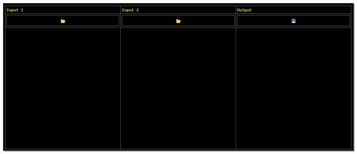

# `bookmark_merge`

- sort by title.
- unique (de-duplicate) by URL (you can have same title bookmarks as long they have different URL).
- optionally merge two bookmarks HTML into one.
- collapses same name folders.
- removes everything other than title and URL from bookmarks entries (index, favicon, date and times).
- removes empty folders.
- removes bookmarks without URL.
- sort folders first.
- natural sort, supporting any language in Unicode.
- cleans up weird incompatible characters from titles.
- removes duplicates across all folders. first comes first stays.
- designed to give you a deterministic, lean, end-result.
- it is an online tool since you access the website online, but it works completely 100% offline. your bookmarks are safe and private. no data-collection. no ads, no analytics, all the logic loads up and stays in your browser.
- you can click to open files instead of copy paste them, they are not being uploaded anywhere everything stays in your browser.
- clicking the save button will generate a HTML file for you, that is compatible with all browsers. name is generated by the current date and time with html extension.
- merging is optional, if you add a single HTML, it will apply all the fixes to just it.
- there is no "start" button, it works as soon you paste or type or add a file to one of the first two text-area elements (third one is the result and is read-only).

<hr/>

the UI is very simple



<hr/>

developers can fork and adjust the first part of `index.js` (until it will have its own sticky-cookie/UI switches),  
the sorting uses a `collator` that its sensitivity is set to `base`, ignoring letter-case and language-related characters slight change, which helps to get a more uniform result.

```js
const is_folders_first = true;
const is_ignore_leading_symbols = true;
const is_ignore_leading_articles = true;
const indent_unit = '    ';

const is_ignore_about_blank_bookmarks = true; // true: drop bookmarks whose URL is about:blank.
const is_deduplicate_across_folders = true;   // true: keep only the first occurrence of each exact URL in the whole tree.
const is_remove_empty_folders = true;         // true: drop folders that end up with no bookmarks, including nested ones.

// Cleaning switches. Titles are cleaned during the gather step, before sorting.
// URLs are cleaned during the gather step, before any uniquification.
const is_trim_titles = true;                  // true: trim leading/trailing whitespace from folder and bookmark titles.
const is_ignore_bookmarks_without_url = true; // true: drop bookmarks whose href is missing or empty.
const is_normalize_url = true;                // true: re-construct URLs, remove trailing "/" suffix, remove duplicated query arguments (order preserved).
const is_https_everywhere = true;             // true: upgrade http:// to https:// except for localhost and private network IPs.
const is_normalize_titles = true;             // true: remove non-ASCII (emoji etc.), control characters and non-viable unicode, unify whitespace to a single space.

const illegal_character_pattern = /[\u0000-\u0008\u000B\u000C\u000E-\u001F\u007F]/g;
const skipped_tag_names = new Set([
  'SCRIPT', 'STYLE', 'TEMPLATE', 'NOSCRIPT', 'IFRAME', 'OBJECT', 'EMBED',
  'HEAD', 'TITLE', 'META', 'LINK', 'HR'
]);
const html_escape_map = { '&': '&amp;', '<': '&lt;', '>': '&gt;', '"': '&quot;' };

const title_collator = new Intl.Collator(undefined, {
  usage: 'sort',
  sensitivity: 'base',
  ignorePunctuation: false,
  numeric: true
});
```